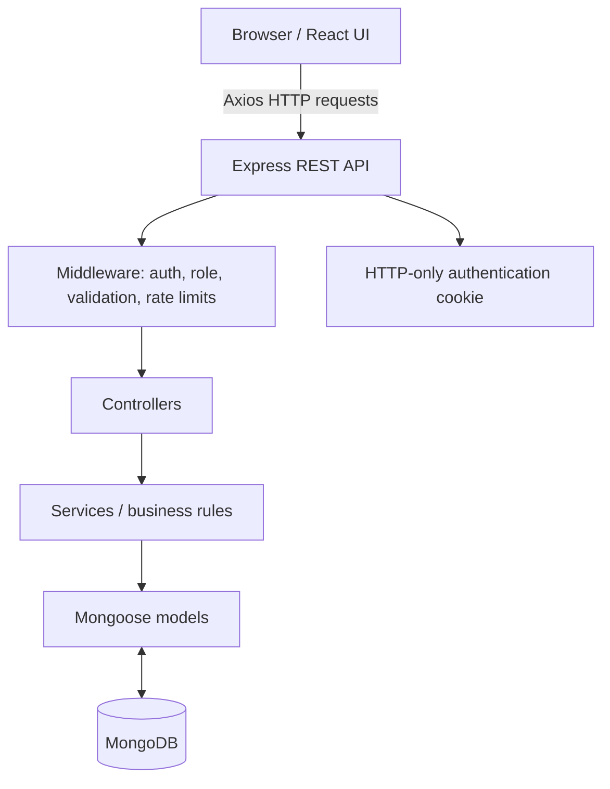

# Solution Architecture

## Layers
1. **Presentation:** React pages, shared components, layouts, context, hooks and API clients.
2. **API:** Express routes and controllers expose versioned endpoints under `/api/v1`.
3. **Business logic:** services handle booking, seats, payments, show management and admin operations.
4. **Persistence:** Mongoose models map application entities to MongoDB collections.

## Folder structure
- `client/src/api/` — API wrappers.
- `client/src/components/` — shared and admin UI components.
- `client/src/pages/` — user and admin pages.
- `server/src/routes/` — endpoint declarations.
- `server/src/controllers/` — request/response handling.
- `server/src/services/` — business rules.
- `server/src/models/` — MongoDB schemas and indexes.
- `server/src/middleware/` — authentication, validation, role checks and error handling.
- `server/src/validators/` — request validation rules.
