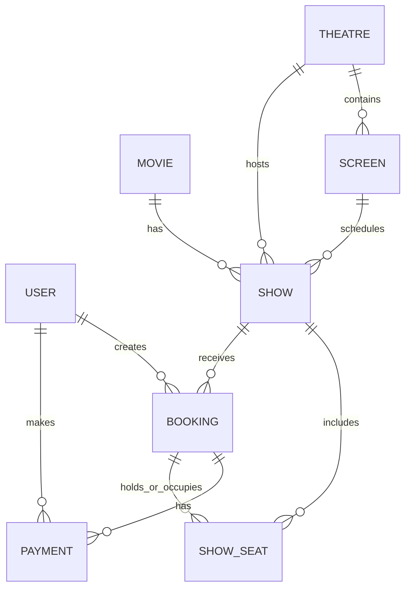

# Database Design

The supplied source contains eight Mongoose models. MongoDB collection names may be pluralized by Mongoose.

| Entity | Main fields | Relationships / constraints |
|---|---|---|
| User | name, email, passwordHash, role, timestamps | Email unique; passwordHash excluded from normal query/JSON output |
| Movie | title, description, genres, language, durationMins, releaseDate, posterUrl, trailerUrl, rating, cast, status | Indexes on status/releaseDate, genres, language and title |
| Theatre | name, city, address | Unique compound index on name + city; index on city |
| Screen | theatre, name, layout.rows | References Theatre; unique theatre + screen name |
| Show | movie, theatre, screen, startsAt, endsAt, pricing, isActive | References Movie/Theatre/Screen; unique screen + startsAt |
| ShowSeat | show, label, row, number, tier, price, status, booking, holdExpiresAt | Unique show + label; indexes support status and expiry queries |
| Booking | reference, user, show, showStartsAt, seats snapshot, totalAmount, status, paymentStatus, hold/cancel metadata | Unique reference; partial unique user + show for pending-payment bookings |
| Payment | booking, user, amount, status, provider, transactionRef, idempotencyKey, failureReason, refundedAmount | Unique transactionRef and booking + idempotencyKey |

## ER diagram

The diagram is conceptual; a seat can reference its current booking while the booking also stores a seat snapshot. See model files for exact field types and indexes.
