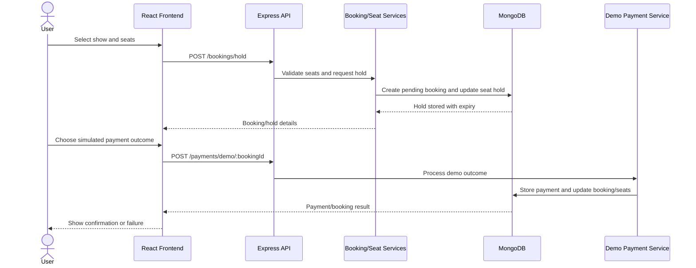
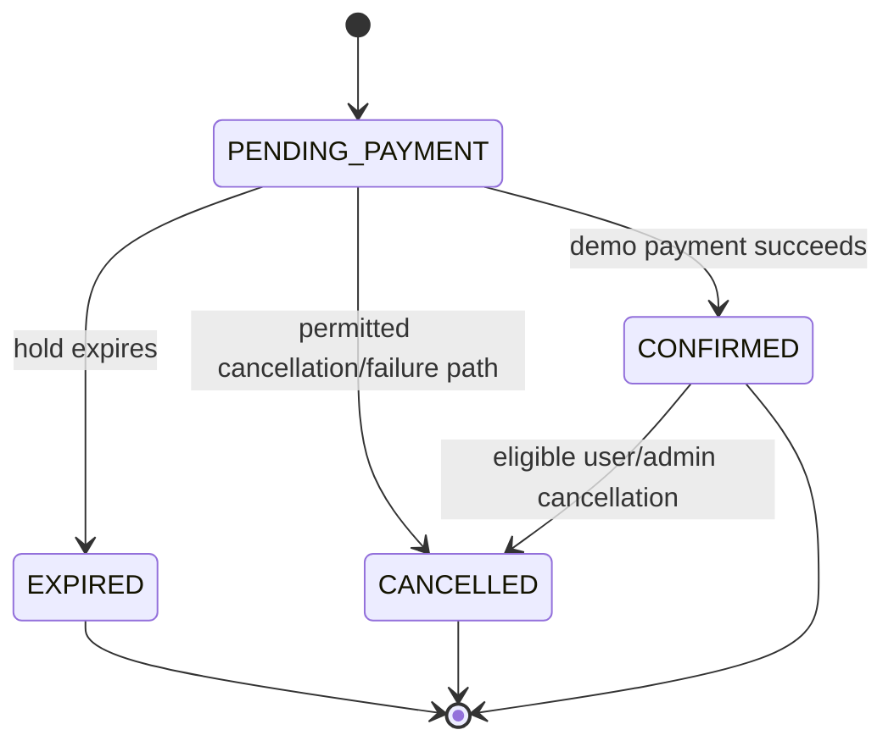

# Booking Flow and State Diagrams

## Booking sequence

## Simplified booking state

## Notes
- Seats are temporarily held before payment.
- The default hold duration documented in the project README is 7 minutes; verify configuration before final submission.
- Payments are simulated and do not charge a real account.
- User cancellation/refund eligibility is time-dependent. Do not quote exact refund thresholds without checking the current service implementation.
